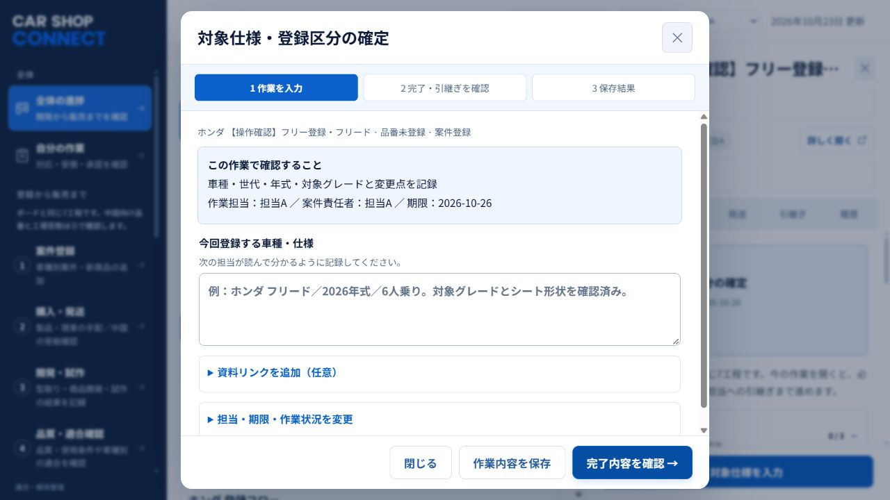
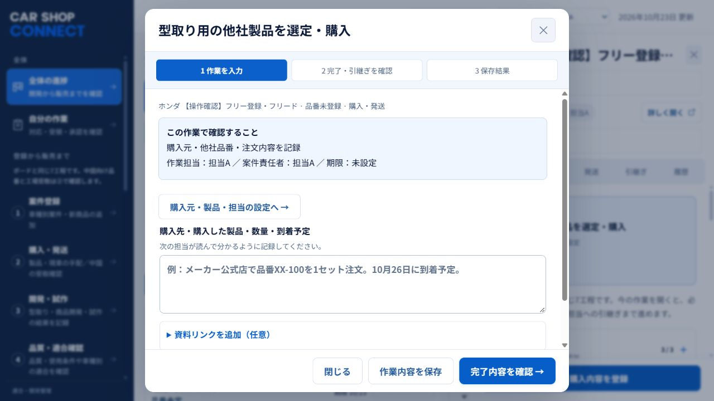

# 次の担当者への引継ぎ

2026-10-23。元担当者は作業を終了し、次の担当者がソースを取得して改修・起動・検証を続けるための公開版です。[READMEの起動手順](README.md)から始めてください。

## 公開した範囲

- この管理画面のアプリ本体・サンプル・テスト・起動スクリプト・画面例のみ。
- 実案件DB、管理シート、実送り状、認証情報、社内接続ソース、他のプロジェクト、非公開リポジトリの履歴は含みません。
- 既存の非公開リポジトリは非公開のまま保持しています。この公開リポジトリは独立した履歴です。

## 今できること

全体の進捗が最上段です。一覧表と工程別ボードを切り替えられます。基準は2026-10-16に公開された画面の7工程です。

**①案件登録 → ②購入・発送 → ③開発・試作 → ④品質・適合確認 → ⑤品番登録・販売準備 → ⑥販売開始の承認 → ⑦販売開始**

案件を登録し、作業を開いて内容を入力、完了を確認し、次の作業へ進むか次担当へ引き継ぎます。相手は上部のサンプル担当を切り替えて受領できます。正式な販売開始は最終確認者として承認します。

担当未定の登録はサンプル担当を仮設定し、確認画面に表示します。別担当の案件も作業の入力・完了ができます。これらの自由操作はサンプル用です。必要な前工程や受領を飛ばす変更はしていません。

入力欄は、作業ごとに「今回登録する車種・仕様」「確認した既存品番と今回開発する理由」「次の作業をする人・期限・手配するもの」などの項目名と例を表示します。写真・資料のリンクは任意で開いて追加します。

## 主な改修場所

| 場所 | 内容 |
| --- | --- |
| `src/App.jsx` | サンプルの起動・画面切替・保存・通知 |
| `src/CaseEntryForm.jsx` | 案件の登録フォーム |
| `src/GuidedTaskDialog.jsx` | 作業入力・完了・次の担当への引継ぎ |
| `src/TaskWorkFields.jsx` | 作業別の入力名・記入例・資料リンク |
| `src/case-workflow.mjs` | 引継ぎ依頼・受領の状態処理 |
| `src/guided-completion.mjs` | 完了と引継ぎの一括処理 |
| `src/sample-data.mjs` | 初期サンプル・新規サンプル作成 |
| `worker/` | 公開用の処理 |
| `tests/` | 動作の自動確認 |

## 残っていること

1. 社員の初見操作で、登録・完了・引継ぎ・受領の迷う箇所を改善する。
2. 既存商品の品番追加と新商品開発を各1件、販売開始・通知まで通して確認する。今回の手操作確認は新規登録から②購入・発送まで。
3. 実案件を複数人で管理する場合は、共有DB、ログインと権限、同時編集、実適合DBとの接続を実装・検証する。サンプルの自由編集を実データへそのまま適用しない。
4. 実案件を扱う前に、最新シート・現在の進捗・既存の定期実行を管理者と照合する。クラッツィオ情報の取得頻度は1日1回という既存方針を維持する。

現在のサンプル入力はタブ内のメモリー保存です。再読み込みで初期化され、別PCや別タブには共有されません。ブラウザー入力はGitにも保存されません。

## 公開先と社内環境

このコードを取得して改修するために、元担当者の認証情報は不要です。自分のGitHubへForkして保存できます。同じ共有URLを直接更新するには、その公開サービス側の編集権限が別途必要です。権限がない場合は自分の公開先を使用してください。

社内m-connectの新管理は停止中です。既存の適合DB・旧管理・保存データを保持し、再開指示なしに再有効化・更新・本番公開をしないでください。

## 操作確認の画面例

